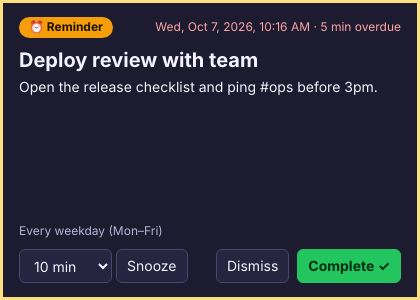

# RemindMe — always-on-top reminders for Chrome

RemindMe is a **Chrome extension** for creating and managing reminders, plus a
**desktop companion app** that shows each reminder in an **always-on-top
window** above every application. The window appears over Visual Studio,
SQL Server Management Studio, Outlook, Teams, Notepad and other browsers.
It appears when Chrome is minimized, in the background, or closed.



## Why two parts?

A Chrome extension can only use Chrome's notifications. Windows toasts and the
macOS Notification Center can hide or group those notifications, and they
cannot stay above other applications. An extension also stops running when
Chrome is closed. To keep a reminder on top of everything, RemindMe uses a
small desktop app:

```
┌───────────────────────────┐   HTTP on 127.0.0.1:47321    ┌──────────────────────────────┐
│ Chrome extension (MV3)    │  ──── POST /api/sync ──────▶ │ RemindMe Companion (Electron) │
│  • popup: create / edit   │ ◀─── merged reminders ────── │  • tray icon, starts at login │
│  • recurring rules        │                              │  • own copy of reminders      │
│  • Chrome fallback alerts │                              │  • always-on-top overlays     │
└───────────────────────────┘                              └──────────────────────────────┘
```

* You create and manage reminders in the **extension popup**. The extension
  syncs every change to the companion right away, and again at least once a
  minute.
* The **companion** keeps its own copy of the reminders on disk and runs its
  own scheduler. Reminders still fire when Chrome is closed.
* When a reminder is due, the companion opens a frameless window in the
  top-right corner of the screen. The window uses the `screen-saver`
  always-on-top level, which is the highest level Electron offers. It shows:
  * the title
  * the message
  * the date and time it was due, and how overdue it is
  * the repeat rule
  * a **Snooze** list (5 min to 1 day), **Dismiss** and **Complete** buttons
* The window **cannot be closed** without one of those three actions. Every
  5 seconds the companion moves it back to the top, in case another
  application covered it. The window plays a chime and flashes in the taskbar.
  It does **not** take keyboard focus, so text you are typing in another
  application doesn't land on its buttons by accident.
* An action in the overlay syncs back to the extension. An edit or deletion
  in the extension closes any overlay that no longer applies.
* **If the companion isn't running**, the extension falls back to Chrome-only
  alerts: a persistent Chrome notification with Snooze and Complete buttons,
  and a focused popup window. These cannot stay above other applications.
  The popup shows a warning while the companion is offline.

### Recurring reminders

* Does not repeat
* Every N minutes
* Every N hours
* Daily, or every N days
* Every weekday (Mon–Fri)
* Weekly on chosen days, or every N weeks
* Monthly, or every N months. Dates late in the month are clamped: Jan 31 →
  Feb 28 → Mar 31.
* Yearly

Repeats are calculated in local time, so a reminder keeps its time of day
across daylight-saving changes. **Complete** or **Dismiss** on a repeating
reminder moves it to the next occurrence. If the computer was off or asleep
and several occurrences were missed, the reminder rings once and then moves
to the next future occurrence.

Actions:

| Action   | One-time reminder | Repeating reminder |
|----------|-------------------|--------------------|
| Snooze   | Rings again after the chosen time | Rings again after the chosen time |
| Dismiss  | Closed, listed as *dismissed* | Moves to the next occurrence |
| Complete | Closed, listed as *completed* | Moves to the next occurrence (counted as completed) |

## Install

### 1. Desktop companion

You need [Node.js](https://nodejs.org/) 18 or later.

```bash
cd companion
npm install
npm start            # run from source
npm run dist:win     # or build an installer: dist:mac / dist:linux
```

`npm run dist:win` creates an NSIS installer and a portable `.exe` in
`companion/dist/`. Once the companion is running:

* It appears as an alarm-clock icon in the system tray. Click the icon to
  open the menu.
* In the tray menu, tick **Start with Windows / at login** so reminders work
  after a reboot without opening Chrome.
* Use **Show test reminder** to check that the overlay appears over your other
  applications.
* **Pause reminders** and **Play sound** are also in the tray menu.

### 2. Chrome extension

1. Open `chrome://extensions` and turn on **Developer mode**.
2. Click **Load unpacked** and select the `extension/` folder.
3. Pin **RemindMe** to the toolbar and open it. The badge in the popup should
   read **Companion connected**.

## Configuration

The companion stores its data in the Electron user-data folder. The tray menu
has **Open data folder**. On Windows the folder is
`%APPDATA%\RemindMe Companion\`. It contains:

* `reminders.json`: the companion's copy of your reminders.
* `settings.json`, with these keys:
  * `port`: default `47321`. If you change it, also change **Companion URL**
    in the extension settings.
  * `playSound`
  * `paused`
  * `allowedExtensionIds`: lock the bridge to your extension's ID, for
    example `["abcdefghijklmnopabcdefghijklmnop"]`. The ID is shown on
    `chrome://extensions`. When the list is empty, any Chrome extension can
    connect.

Restart the companion after you edit `settings.json`.

The **Settings** section of the extension popup has:

* the companion URL
* the default snooze length
* whether to use the Chrome fallback when the companion is offline
* a **Show test reminder** button

### Security

The bridge only listens on `127.0.0.1`. It only accepts a request when both
of these are true:

* The request comes from a `chrome-extension://` origin. You can narrow this
  to specific extension IDs with `allowedExtensionIds`.
* The request carries an `X-RemindMe-Client` header. Because of this header,
  browsers send a CORS preflight first, so ordinary web pages can't read or
  change your reminders.

## Development

```bash
npm test             # unit and integration tests (node:test, no dependencies)
npm run sync-core    # after editing extension/lib/core.js
npm run icons        # regenerate the PNG icons
```

`extension/lib/core.js` contains the reminder model, the repeat calculations,
the snooze/dismiss/complete rules and the merge logic. The extension and the
companion both use it. The companion keeps a copy at `companion/src/core.js`,
and a test fails if the two files differ.

```
extension/            Chrome extension (Manifest V3)
  background.js       service worker: storage, alarms, sync, Chrome fallback
  popup.*             create/edit/list reminders, settings
  reminder.*          fallback reminder window (companion offline)
  lib/core.js         shared core
companion/            Electron desktop app
  src/main.js         tray, overlay windows, always-on-top handling
  src/server.js       local HTTP bridge
  src/store.js        persisted reminder store
  src/scheduler.js    decides which reminders are ringing
  src/overlay/        overlay window UI (sandboxed, context-isolated)
test/                 tests
```

## Known limitations

* **Exclusive full-screen apps** (some games, presentation modes) can draw
  over every window, including always-on-top ones. Borderless full-screen
  windows are fine.
* **Windows focus rules:** the overlay does not take keyboard focus, on
  purpose. It sits on top and flashes in the taskbar instead.
* **Chrome fallback only:** without the companion, reminders fire only while
  Chrome is running. In Chrome settings, turn on *Continue running background
  apps when Google Chrome is closed* so the extension keeps running after the
  last window closes.
